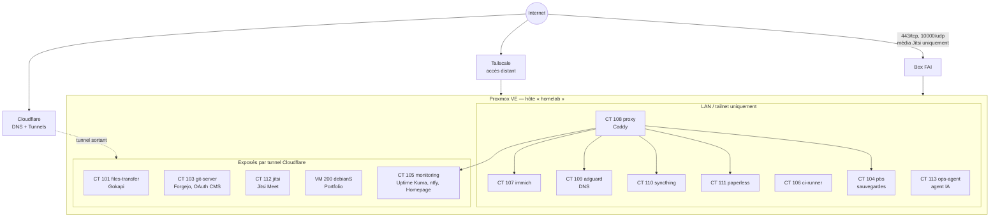
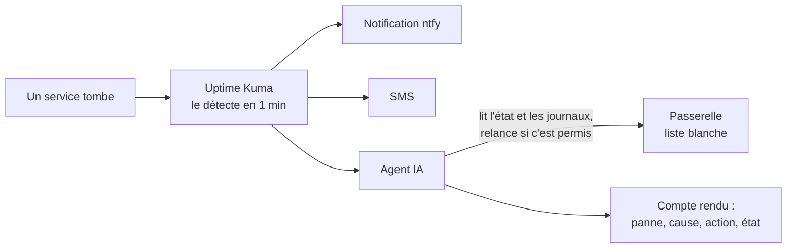

# Homelab

Documentation de mon homelab personnel : un seul mini-PC sous Proxmox VE qui héberge une douzaine de services dans des conteneurs LXC et une VM.

Ce dépôt décrit **l'architecture** (qui tourne où, comment ça communique, comment c'est sauvegardé et surveillé). Il ne contient aucun secret, ni fichier de configuration brut.

## Vue d'ensemble

## Matériel

| Élément | Détail |
|---|---|
| Machine | Mini-PC, AMD Ryzen 7 5825U (8 cœurs / 16 threads) |
| Mémoire | 16 Go |
| Stockage | NVMe (LVM, thin pool pour les invités) |
| Sauvegarde externe | SSD USB chiffré LUKS2 |
| Hyperviseur | Proxmox VE 9.2 |
| Réseau | 1 interface, pont `vmbr0`, LAN unique (un `/24` privé) |

## Services

| ID | Nom | Rôle | Pile | Accès |
|---|---|---|---|---|
| CT 101 | `files-transfer` | Transfert de fichiers chiffré de bout en bout | Gokapi | Public (tunnel) |
| CT 103 | `git-server` | Forge Git, dépôt des secrets (gopass), proxy OAuth du CMS | Forgejo | Public (tunnel), SSH Git en LAN |
| CT 104 | `pbs` | Serveur de sauvegardes | Proxmox Backup Server | LAN |
| CT 105 | `monitoring` | Supervision, notifications, page d'accueil | Uptime Kuma, ntfy, Homepage (Docker) | LAN ; ntfy public (tunnel) |
| CT 106 | `ci-runner` | Exécuteur CI de la forge | Forgejo Runner (Docker) | Aucun (sortant) |
| CT 107 | `immich` | Photothèque | Immich (Docker) | LAN |
| CT 108 | `proxy` | Reverse proxy HTTPS interne | Caddy | LAN |
| CT 109 | `adguard` | DNS filtrant du LAN | AdGuard Home | LAN |
| CT 110 | `syncthing` | Synchronisation de fichiers | Syncthing | LAN |
| CT 111 | `paperless` | Gestion documentaire, OCR | Paperless-ngx (Docker) | LAN |
| CT 112 | `jitsi` | Visioconférence | Jitsi Meet (Docker), coturn | Public (tunnel + ports média) |
| CT 113 | `ops-agent` | Agent IA d'exploitation | Claude Code en mode non interactif | Aucun (webhook interne) |
| VM 200 | `debianS` | Site portfolio | Astro (statique), nginx | Public (tunnel) |

Tous les conteneurs sont **non privilégiés**.

## Documentation détaillée

- [Réseau](docs/reseau.md) — adressage, exposition publique, proxy interne, accès distant, matrice des flux, DNS
- [Services](docs/services.md) — détail de chaque conteneur et de la VM, tâches planifiées, stockage
- [Sauvegardes](docs/sauvegardes.md) — PBS, SSD USB chiffré, rétention
- [Sécurité](docs/securite.md) — pare-feu, SSH, gestion des secrets, protections de l'agent IA
- [Supervision et agent IA](docs/supervision.md) — sondes, canaux d'alerte, réparation automatique encadrée, essais
- [Exploitation](docs/exploitation.md) — gestes courants : réagir à une alerte, ajouter un invité, restaurer, mettre à jour
- [Journal des évolutions](docs/journal.md) — chronologie et décisions d'architecture

## Parcours d'une panne

## Principes

- **Un service = un conteneur.** Isolation simple, sauvegarde et restauration unitaires.
- **Aucun port entrant pour le web.** Tout ce qui est public passe par des tunnels Cloudflare sortants (le FAI bloque de toute façon la redirection des ports bas).
- **Refus par défaut.** Le pare-feu Proxmox bloque le trafic entre invités, sauf exceptions explicites.
- **Les secrets ne vivent pas dans les dépôts.** Ils sont chiffrés avec GPG dans un magasin gopass.
- **L'automatisation est bornée.** L'agent IA n'agit qu'à travers une liste blanche de commandes.
