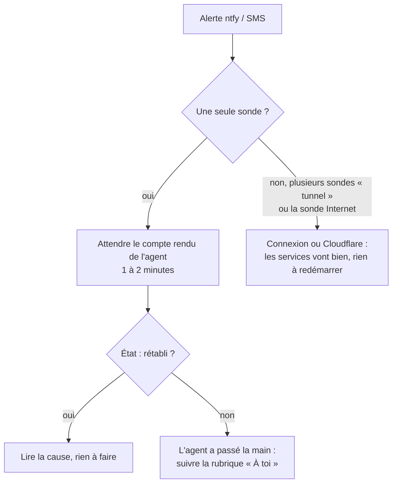

# Exploitation

Aide-mémoire des gestes courants. Les commandes se lancent sur l'hôte Proxmox, sauf mention contraire.

## Au quotidien

| Je veux… | Où regarder |
|---|---|
| Voir d'un coup d'œil si tout va bien | Page d'accueil (`accueil.home…`) ou Uptime Kuma (`kuma.home…`) |
| Savoir pourquoi une sonde est tombée | Compte rendu de l'agent IA sur ntfy, puis le journal du service concerné |
| Voir ce que l'agent a fait | `/var/log/homelab-agent-gate.log` (chaque commande, acceptée ou refusée) |
| Voir ce que l'agent a reçu | `pct exec 113 -- journalctl -u ops-agent` |
| Vérifier les sauvegardes | Interface PBS (`pbs.home…`), ou les trois sondes « Sauvegarde » dans Kuma |

## Réagir à une alerte



Une sonde **push** en alerte (capacité, SMART, sauvegardes) ne se règle jamais par un redémarrage : l'agent se contente d'expliquer.

## Agent IA

**Suspendre l'agent** (maintenance, série d'alertes attendues) :

```sh
pct exec 113 -- touch /etc/ops-agent/PAUSE      # suspendre
pct exec 113 -- rm /etc/ops-agent/PAUSE         # reprendre
```

En pause, les alertes continuent d'arriver sur ntfy et par SMS ; seule l'analyse automatique s'arrête.

**Renouveler le jeton Claude** : le générer sur un poste personnel, puis l'installer avec le script prévu sur l'hôte (`ops-agent-set-token`), qui l'écrit dans un fichier à droits restreints du conteneur. Sans jeton valide, l'agent le signale par une notification à la première alerte.

**Essayer la chaîne complète** : depuis le conteneur de supervision, envoyer au webhook une fausse panne dont le message précise qu'il s'agit d'un essai. L'agent doit conclure « sonde déjà revenue, aucune action ». L'essai consomme une analyse du quota horaire.

**Autoriser un nouveau redémarrage** : modifier les listes en tête de la passerelle (`homelab-agent-gate`) — une liste pour ce qui est *consultable*, une autre pour ce qui est *redémarrable*. Ne jamais y mettre une base de données, le serveur de sauvegardes ni la chaîne d'alerte.

## Ajouter un invité

Le pare-feu refuse par défaut : un invité oublié dans une des étapes ci-dessous est soit injoignable, soit non isolé.

1. Créer le conteneur **non privilégié**, avec une adresse statique hors de la plage DHCP.
2. Lui donner un ordre de démarrage (voir [Réseau](reseau.md)).
3. **Pare-feu** : l'ajouter au groupe d'adresses `guests`, créer son fichier de règles sur le modèle des autres, activer le pare-feu sur son interface.
4. **Mises à jour** : installer `unattended-upgrades`.
5. **Exposition** : une entrée dans Caddy pour un service interne, ou un tunnel Cloudflare dédié pour un service public.
6. **Supervision** : une sonde dans Uptime Kuma (avec ses trois notifications), une tuile sur la page d'accueil, et l'ouverture du port du service au conteneur de supervision.
7. **Agent IA** : l'ajouter aux listes de la passerelle si l'agent doit pouvoir le consulter ou le relancer.
8. **Sauvegarde** : rien à faire, la tâche quotidienne prend tous les invités. Vérifier le lendemain qu'il apparaît dans PBS.
9. **Documentation** : mettre à jour ce dépôt.

## Sauvegarder et restaurer

**Lancer une copie sur le SSD USB** : brancher le disque suffit. La copie démarre seule et le disque peut être débranché une fois la notification de fin reçue.

**Restaurer un invité** : depuis l'interface Proxmox, stockage PBS → choisir la sauvegarde → *Restaurer*. Pour récupérer seulement quelques fichiers, utiliser l'explorateur de fichiers de la sauvegarde plutôt qu'une restauration complète.

**Reconstruire l'hôte** (disque mort) :

1. réinstaller Proxmox VE ;
2. déverrouiller le SSD USB avec la phrase de secours (magasin de secrets) ;
3. restaurer la configuration du nœud depuis l'archive du SSD ;
4. restaurer le conteneur PBS depuis le SSD, puis tous les autres invités depuis PBS (plus récent) ou depuis le SSD.

C'est la raison pour laquelle le SSD contient PBS lui-même : sans lui, il faudrait d'abord reconstruire le serveur de sauvegardes pour pouvoir restaurer quoi que ce soit.

## Mettre à jour

| Quoi | Comment |
|---|---|
| Invités (correctifs de sécurité) | Automatique (`unattended-upgrades`), sans redémarrage automatique |
| Hôte Proxmox | **À la main**, après l'alerte « mises à jour disponibles ». Volontaire : une mise à jour de l'hyperviseur ne doit pas arriver sans surveillance. |
| Applications en Docker | À la main, versions épinglées pour les applications à données (Immich, Paperless-ngx, Jitsi) |

Avant une mise à jour de l'hôte ou une montée de version d'une application à données : vérifier que la sauvegarde de la nuit est passée, et suspendre l'agent le temps de l'opération.

**Piège connu.** La mise à jour de Tailscale coupe la session SSH ouverte par le tailnet ; la mise à jour continue quand même. Passer par le LAN pour ce genre d'opération.

## Après un redémarrage de l'hôte

- Les invités repartent seuls, dans l'ordre défini.
- **La VM `debianS` attend** : son disque est chiffré, la phrase de passe doit être saisie dans la console Proxmox. Tant que ce n'est pas fait, le portfolio est hors ligne et sa sonde reste en alerte.
- Vérifier dans Kuma que toutes les sondes repassent au vert.

## Si l'adresse IP publique change

Une alerte ntfy le signale. La nouvelle adresse doit être reportée dans la configuration de Jitsi (adresses annoncées par le pont vidéo et par coturn), puis les conteneurs concernés relancés. Le web n'est pas touché : il passe par les tunnels.
