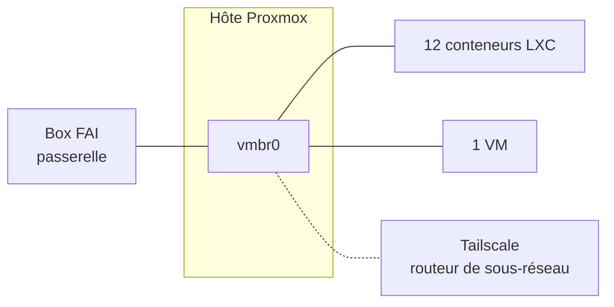

# Réseau

## Topologie

Le homelab est volontairement plat : un seul LAN (un `/24` privé), un seul pont Proxmox (`vmbr0`) relié à l'unique interface physique. Il n'y a pas de VLAN ; le cloisonnement entre invités est assuré par le pare-feu Proxmox (voir [Sécurité](securite.md)).

## Adressage

- Chaque invité a une **adresse statique** sur le LAN, hors de la plage DHCP de la box.
- Les adresses exactes ne sont volontairement pas publiées ici.
- Les invités sont référencés dans le pare-feu par un groupe d'adresses (`guests`), ce qui permet d'écrire des règles « tout invité → … » sans les énumérer.

## Trois chemins d'accès

### 1. Public : tunnels Cloudflare

Le FAI ne permet pas de rediriger les ports bas (80, 443). Les services publics sont donc exposés par des **tunnels Cloudflare** : un démon `cloudflared` dans chaque invité concerné ouvre une connexion *sortante* vers Cloudflare, qui termine le TLS et relaie les requêtes. Aucun port n'est ouvert sur la box pour le web.

Chaque invité public a son propre tunnel, ce qui évite qu'un invité compromis serve de rebond vers les autres.

| Nom public | Invité | Service |
|---|---|---|
| `vnaoussi-djoumessi.com` | VM 200 | Portfolio (nginx) |
| `files.vnaoussi-djoumessi.com` | CT 101 | Gokapi |
| `git.vnaoussi-djoumessi.com` | CT 103 | Forgejo (HTTPS uniquement) |
| `cms-auth.vnaoussi-djoumessi.com` | CT 103 | Proxy OAuth de Decap CMS |
| `ntfy.vnaoussi-djoumessi.com` | CT 105 | ntfy (notifications sur téléphone) |
| `meet.vnaoussi-djoumessi.com` | CT 112 | Jitsi Meet (interface web) |

**Exception Jitsi.** Les flux audio/vidéo ne passent pas par un tunnel HTTP. Deux ports sont redirigés sur la box vers le CT 112 : `10000/udp` (pont vidéo) et `443/tcp` (coturn, repli TURN sur TLS pour les réseaux restrictifs).

### 2. Interne : reverse proxy Caddy

Les services privés sont joignables en HTTPS sous `*.home.vnaoussi-djoumessi.com` via Caddy (CT 108).

- Les enregistrements DNS pointent vers l'adresse privée du proxy : ces noms ne répondent que depuis le LAN ou le tailnet.
- Le certificat est un **wildcard Let's Encrypt** obtenu par défi DNS (API Cloudflare). Aucun service n'a besoin d'être joignable depuis Internet pour obtenir un certificat valide.

| Nom interne | Cible |
|---|---|
| `accueil.home…` | Homepage (CT 105) |
| `kuma.home…` | Uptime Kuma (CT 105) |
| `photos.home…` | Immich (CT 107) |
| `adguard.home…` | AdGuard Home (CT 109) |
| `syncthing.home…` | Syncthing (CT 110) |
| `papiers.home…` | Paperless-ngx (CT 111) |
| `pve.home…` | Interface Proxmox VE (hôte) |
| `pbs.home…` | Interface Proxmox Backup Server (CT 104) |

### 3. Distant : Tailscale

L'hôte Proxmox est membre d'un tailnet et **annonce le sous-réseau du LAN** (routeur de sous-réseau). Depuis un ordinateur ou un téléphone connecté au tailnet, tous les services internes sont accessibles comme à la maison, y compris les noms `*.home`.

L'administration (SSH, interfaces Proxmox et PBS) n'est possible que depuis le LAN ou le tailnet.

## DNS

AdGuard Home (CT 109) sert de résolveur filtrant pour le LAN et pour les invités. C'est l'un des premiers conteneurs à démarrer (ordre 1, avec PBS).

## Ordre de démarrage

| Ordre | Invités |
|---|---|
| 1 | `adguard`, `pbs` |
| 2 | `proxy`, `monitoring` |
| 3 | `ci-runner`, `syncthing` |
| 4 | `immich`, `paperless`, `jitsi`, `ops-agent` |
| — | `files-transfer`, `git-server`, `debianS` (sans ordre imposé) |
