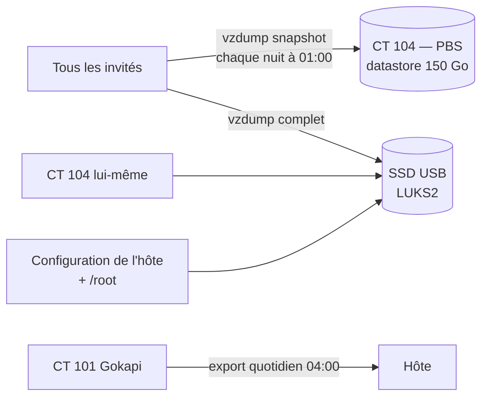

# Sauvegardes

## Niveau 1 — Proxmox Backup Server (quotidien)

- **Quoi** : tous les invités, sauf PBS lui-même.
- **Quand** : chaque nuit à 01:00, en mode *snapshot* (sans arrêt des services).
- **Où** : datastore `homelab` du CT 104. Sauvegardes dédupliquées et incrémentales.
- **Rétention** (tâche de purge à 03:00) : 7 quotidiennes, 4 hebdomadaires, 6 mensuelles.
- **Entretien** : ramasse-miettes chaque nuit à 03:30, vérification d'intégrité le dimanche à 05:00 (re-vérification après 30 jours).

## Niveau 2 — SSD USB chiffré

Une seconde copie, indépendante de PBS, part sur un SSD externe.

- **Déclenchement** : automatique au branchement du disque (règle udev → unité systemd), ou à la demande à distance.
- **Chiffrement** : partition LUKS2. Déverrouillage par fichier-clé sur l'hôte ; une phrase de secours est conservée dans le magasin de secrets.
- **Contenu** :
  - sauvegarde complète de tous les invités, **PBS inclus** (5 dernières conservées) ;
  - archive de la configuration du nœud Proxmox (10 dernières) ;
  - archive de `/root` de l'hôte, hors caches (3 dernières).

## Sauvegarde applicative de Gokapi

En plus de la sauvegarde du conteneur, l'hôte récupère chaque nuit à 04:00 un export des données de Gokapi.

## Surveillance des sauvegardes

Trois sondes « push » dans Uptime Kuma passent en alerte si :

- la sauvegarde PBS de la nuit a échoué ou manque ;
- la dernière sauvegarde USB date de plus de 14 jours ;
- l'export Gokapi n'a pas eu lieu.
