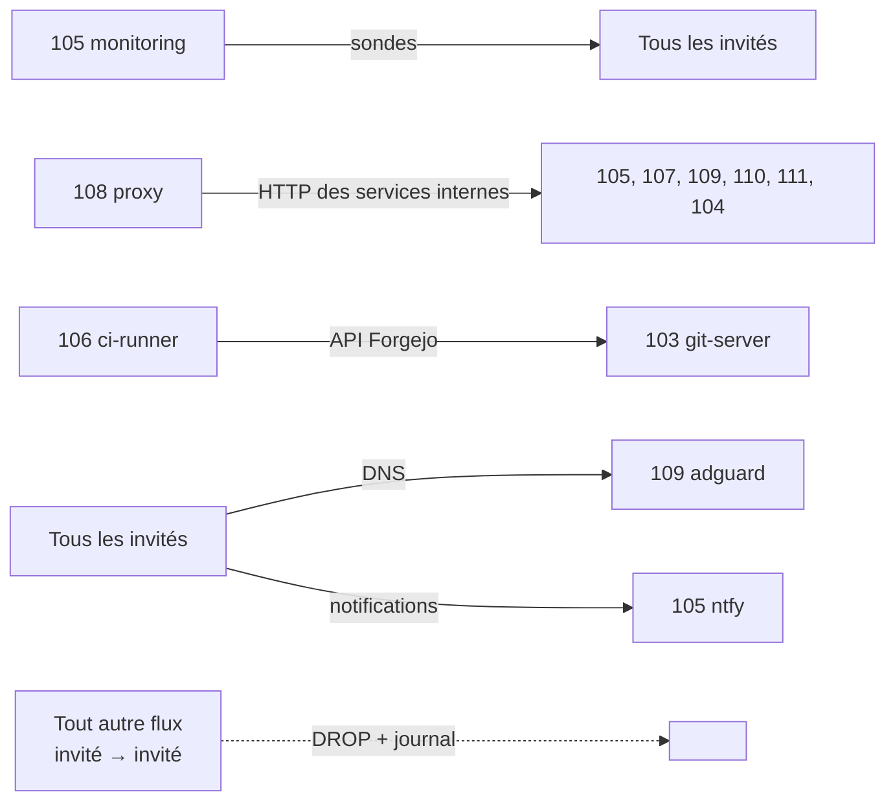

# Sécurité

## Surface d'exposition

| Depuis Internet | Mécanisme |
|---|---|
| Sites et applications web publics | Tunnels Cloudflare (connexions sortantes, TLS terminé chez Cloudflare) |
| Média Jitsi | Deux ports redirigés vers le seul CT 112 |
| Tout le reste | Injoignable |

Les interfaces d'administration (Proxmox, PBS, SSH) ne sont accessibles que depuis le LAN ou le tailnet.

## Pare-feu Proxmox

Le pare-feu est actif à trois niveaux (centre de données, hôte, chaque invité), avec une politique d'entrée **DROP** partout.

Le LAN étant plat, c'est le pare-feu qui cloisonne. Chaque invité applique le même modèle, dans cet ordre :

1. **Exceptions entre invités**, explicites et minimales ;
2. **Refus de tout autre trafic venant d'un invité** (groupe d'adresses `guests`) ;
3. **Ouverture des ports de service** au LAN et au tailnet.

Conséquence : un service compromis ne peut pas explorer ses voisins. Côté hôte, les invités sont refusés, sauf le proxy et la supervision vers l'interface web Proxmox, la supervision vers le relais SMS, et l'agent IA vers sa passerelle SSH.

La liste complète des flux autorisés, port par port, est dans [Réseau — Qui parle à qui](reseau.md#qui-parle-à-qui).

Deux limites assumées de ce modèle :

- **la sortie n'est pas filtrée** : un invité compromis peut toujours joindre Internet (c'est aussi ce qui permet les tunnels et les mises à jour) ;
- **le LAN est de confiance** : un appareil de la maison atteint les ports de service. Le cloisonnement protège les invités les uns des autres, pas contre le réseau domestique.

Les refus sont journalisés. Tout nouvel invité doit être ajouté au groupe `guests`, recevoir son fichier de règles et avoir le pare-feu activé sur son interface.

## SSH

- Authentification **par clé uniquement** sur l'hôte, les conteneurs et la VM.
- fail2ban sur l'hôte, sur les CT 101 et 103 et sur la VM 200.
- SSH des conteneurs limité au LAN et au tailnet par le pare-feu.

## Conteneurs

- Tous **non privilégiés** : root dans un conteneur n'est pas root sur l'hôte.
- `nesting` et `keyctl` ne sont activés que pour les conteneurs qui font tourner Docker.

## Secrets

- Stockés dans **gopass** : un fichier chiffré GPG par secret, versionné dans un dépôt Git privé sur la forge.
- Le serveur ne possède que la clé publique. Le déchiffrement n'est possible que sur mes postes personnels.
- Les jetons nécessaires aux services (API Cloudflare, OAuth, etc.) sont dans des fichiers d'environnement à droits restreints, hors de tout dépôt.

## Chiffrement des données

- **Gokapi** : chiffrement de bout en bout (le serveur ne voit jamais les fichiers en clair).
- **SSD de sauvegarde** : LUKS2.
- **Transport** : TLS partout — Cloudflare pour le public, certificat wildcard Let's Encrypt pour l'interne, WireGuard (Tailscale) pour l'accès distant.

## Mises à jour

Mises à jour de sécurité automatiques (`unattended-upgrades`) sur les invités ; une alerte quotidienne signale les mises à jour en attente sur l'hôte, qui sont appliquées à la main.

## Agent IA

Confier des redémarrages à un modèle de langage est le point le plus sensible de l'installation. Les protections sont empilées, de l'extérieur vers l'intérieur :

| Couche | Protection |
|---|---|
| Réseau | Le webhook de l'agent n'est joignable que par le conteneur de supervision |
| Entrée | Secret dans l'URL ; contenu des alertes traité comme une donnée non fiable |
| Volume | Quotas d'analyses, anti-doublon, durée maximale d'une analyse |
| Modèle | Un seul outil autorisé, aucune autre commande |
| Conteneur | Utilisateur sans privilège, conteneur non privilégié, système de fichiers en lecture seule |
| Hôte | Clé SSH à commande forcée, liste blanche de verbes, limites de débit, journal |

Seule la dernière couche est considérée comme une frontière de sécurité : les autres réduisent la probabilité d'un incident, celle-là en borne les conséquences. Détail dans [Supervision et agent IA](supervision.md).

## Ce que ce dépôt ne publie pas

Ce dépôt est public. Il décrit des mécanismes, pas des coordonnées : ni adresse IP, ni secret, ni fichier de configuration brut, ni nom d'utilisateur d'administration.
