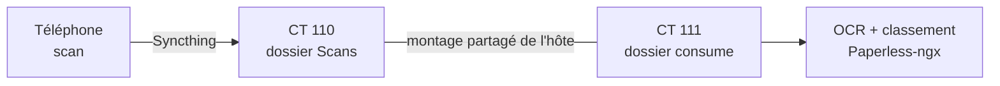

# Services

## Ressources allouées

| ID | Nom | OS | Cœurs | RAM | Disque système | Volume de données |
|---|---|---|---|---|---|---|
| CT 101 | `files-transfer` | Debian 13 | 2 | 1 Go | 8 Go | — |
| CT 103 | `git-server` | Ubuntu 24.04 | 2 | 1 Go | 50 Go | — |
| CT 104 | `pbs` | Debian 13 | 2 | 1 Go | 8 Go | 150 Go (datastore) |
| CT 105 | `monitoring` | Debian 13 | 2 | 1,5 Go | 12 Go | — |
| CT 106 | `ci-runner` | Debian 13 | 4 | 3 Go | 40 Go | — |
| CT 107 | `immich` | Debian 13 | 4 | 4 Go | 20 Go | 80 Go |
| CT 108 | `proxy` | Debian 13 | 1 | 512 Mo | 4 Go | — |
| CT 109 | `adguard` | Debian 13 | 1 | 512 Mo | 4 Go | — |
| CT 110 | `syncthing` | Debian 13 | 1 | 512 Mo | 4 Go | 50 Go |
| CT 111 | `paperless` | Debian 13 | 2 | 2 Go | 10 Go | 50 Go |
| CT 112 | `jitsi` | Debian 13 | 2 | 3 Go | 10 Go | — |
| CT 113 | `ops-agent` | Debian 13 | 1 | 1,5 Go | 8 Go | — |
| VM 200 | `debianS` | Debian 13 | 2 | 4 Go | 31 Go | — |

## Détail par invité

### CT 101 — `files-transfer` (Gokapi)

Partage de fichiers par lien, à durée de vie ou nombre de téléchargements limités. Le chiffrement de bout en bout est activé : les fichiers sont chiffrés dans le navigateur, le serveur ne stocke que du chiffré. Binaire Go unique sous systemd, avec `cloudflared` pour l'exposition publique.

### CT 103 — `git-server` (Forgejo)

- **Forgejo** : forge Git personnelle. Inscriptions fermées. Git sur HTTPS passe par le tunnel ; Git sur SSH n'est accessible que depuis le LAN ou le tailnet.
- **Magasin de secrets** : le dépôt gopass (secrets chiffrés GPG) est hébergé dans Forgejo. Le conteneur ne détient que la clé *publique* : il peut stocker, pas déchiffrer.
- **Proxy OAuth** : petit service Python qui réalise l'échange de jetons GitHub pour Decap CMS (édition du blog du portfolio).

### CT 104 — `pbs` (Proxmox Backup Server)

Cible des sauvegardes quotidiennes de tous les invités. Voir [Sauvegardes](sauvegardes.md).

### CT 105 — `monitoring`

Trois conteneurs Docker :

- **Uptime Kuma** : sondes HTTP/TCP/ping et sondes « push ».
- **ntfy** : notifications vers le téléphone (seul composant exposé publiquement, pour être joignable hors de la maison).
- **Homepage** : page d'accueil listant les services.

### CT 106 — `ci-runner`

Forgejo Runner : exécute les tâches CI de la forge dans des conteneurs Docker. Il n'a aucun port ouvert ; il interroge Forgejo en sortant.

### CT 107 — `immich`

Photothèque auto-hébergée (serveur, apprentissage automatique, PostgreSQL avec extension vectorielle, Valkey). Les photos sont sur un volume dédié de 80 Go.

### CT 108 — `proxy` (Caddy)

Reverse proxy HTTPS des services internes, avec certificat wildcard. Voir [Réseau](reseau.md).

### CT 109 — `adguard` (AdGuard Home)

Résolveur DNS filtrant du LAN.

### CT 110 — `syncthing`

Synchronisation de dossiers entre appareils. Un dossier de l'hôte (`/srv/scans`) est monté à la fois ici et dans Paperless : un document scanné sur le téléphone est synchronisé par Syncthing puis ingéré automatiquement par Paperless.

### CT 111 — `paperless` (Paperless-ngx)

Gestion documentaire avec OCR (serveur web, PostgreSQL, Valkey). Documents sur un volume dédié de 50 Go.

### CT 112 — `jitsi`

Visioconférence : `web`, `prosody` (XMPP), `jicofo` (focus) et `jvb` (pont vidéo) en Docker, plus `coturn` sur l'hôte du conteneur pour le repli TURN.

### CT 113 — `ops-agent`

Agent IA qui reçoit les alertes de panne, diagnostique et peut relancer un service à travers une passerelle à liste blanche. Voir [Supervision et agent IA](supervision.md).

### VM 200 — `debianS`

Site portfolio : site statique Astro servi par nginx, publié par tunnel Cloudflare. Le blog s'édite via Decap CMS (`/admin/`), qui écrit dans le dépôt GitHub du site. C'est la seule VM complète ; elle dispose en plus de son propre pare-feu local (`ufw`) et de fail2ban.

## Sur l'hôte

L'hôte Proxmox ne porte que le minimum :

- **Tailscale** (routeur de sous-réseau) ;
- **Netdata** et **smartd** (métriques et santé du disque) ;
- des scripts planifiés : envoi de l'état de santé aux sondes, sauvegarde sur SSD USB, récupération de la sauvegarde Gokapi, contrôle du thin pool, des mises à jour et de l'adresse IP publique ;
- la **passerelle de l'agent IA** (liste blanche de commandes).
