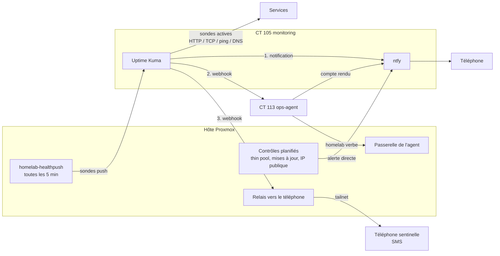
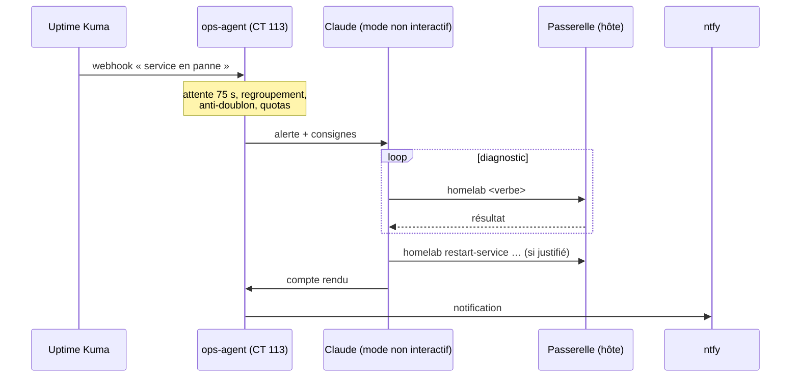

# Supervision et agent IA

## Vue d'ensemble

Une panne déclenche donc trois choses en parallèle : une notification immédiate, un SMS par un canal indépendant, et une analyse par l'agent IA dont le compte rendu arrive une à deux minutes plus tard.

## Sondes

Uptime Kuma porte 28 sondes, réparties en trois familles.

### Sondes actives (20)

Kuma interroge chaque service toutes les 60 secondes.

| Cible | Type | Ce qui est vérifié |
|---|---|---|
| Proxmox VE, PBS | HTTP | Interfaces d'administration |
| Forgejo (local) | HTTP | Point de santé de l'API |
| Forgejo SSH | TCP | Port Git sur SSH |
| Immich, Paperless-ngx, Syncthing, Homepage | HTTP | Point de santé ou page de connexion |
| AdGuard Home (web) | HTTP | Interface |
| AdGuard DNS (résolution) | DNS | Une résolution réelle, pas seulement le port |
| Caddy (`*.home`, certificat) | HTTP | Le proxy interne **et** la validité du certificat wildcard |
| ntfy (local) | HTTP | Point de santé |
| debianS SSH | TCP | Port SSH de la VM |
| Internet | ping | Un résolveur public, pour distinguer « service en panne » de « connexion coupée » |
| Portfolio, Gokapi, Forgejo, cms-auth, ntfy, Jitsi Meet (publics) | HTTP | Les six noms publics, **à travers leur tunnel Cloudflare** |

Les services publics sont donc surveillés deux fois : en local et tels qu'un visiteur les voit. Si seule la sonde « tunnel » tombe, le service va bien et c'est son exposition qui est en cause.

### Sondes push (6)

Kuma ne peut pas voir de lui-même l'état d'un disque ou le résultat d'une sauvegarde. Un script de l'hôte (`homelab-healthpush`, lancé toutes les 5 minutes par un minuteur systemd) fait ces contrôles et envoie le résultat à Kuma. Si le signal cesse plus de 11 minutes, la sonde tombe d'elle-même : une panne du script ou de l'hôte est détectée aussi.

| Sonde push | Passe en alerte si… |
|---|---|
| Capacité | disque système de l'hôte ≥ 85 % ; thin pool (données ou métadonnées) ≥ 80 % ; mémoire disponible de l'hôte < 1 Go ; swap ≥ 75 % ; un volume d'un conteneur ou de la VM ≥ 90 % |
| SMART | test de santé du NVMe non réussi, alerte critique, usure ≥ 80 % ou erreurs d'intégrité |
| Sauvegarde PBS | dernière sauvegarde en échec, ou réussie depuis plus de 26 h |
| Sauvegarde USB | dernière copie réussie vieille de 14 jours ou plus |
| Sauvegarde Gokapi | export quotidien non reçu (tolérance : 26 h) |
| CI runner | service de l'exécuteur CI inactif |

### Sondes de la chaîne d'alerte (2)

Les outils d'alerte sont eux-mêmes surveillés :

- **Agent IA** : point de santé du service dans le CT 113.
- **Téléphone sentinelle** : point de santé du relais SMS, toutes les 2 minutes.

Ces deux sondes ne sont volontairement pas reliées à l'agent : il n'aurait rien à réparer, et un agent en panne ne peut pas s'analyser lui-même.

## Contrôles planifiés hors Kuma

Trois scripts de l'hôte envoient leur alerte directement sur ntfy, sans passer par Kuma :

| Script | Fréquence | Alerte |
|---|---|---|
| `check-thinpool` | toutes les heures | thin pool au-dessus de 80 % |
| `check-updates` | chaque jour à 09:05 | nouvelles mises à jour disponibles sur l'hôte (une seule alerte tant que la liste ne change pas) |
| `check-public-ip` | toutes les 10 minutes | l'adresse IP publique de la box a changé (Jitsi et coturn l'annoncent aux clients : elle doit alors être mise à jour) |

Un quatrième script surveille un appareil de la maison plutôt que le serveur : il relève toutes les 5 minutes l'état d'une télévision Android (par ADB) et, quand elle redémarre, archive ses journaux et envoie une alerte qui précise la cause (plantage du système, arrêt brutal ou redémarrage normal).

## Canaux de notification

| Canal | Mécanisme | Sondes reliées |
|---|---|---|
| **ntfy** | Notification poussée sur le téléphone. Jeton en écriture seule, limité au sujet des alertes. | 28 |
| **SMS** | Webhook vers l'hôte, relayé au téléphone sentinelle par le tailnet. | 27 |
| **Agent IA** | Webhook vers le CT 113. | 26 |

### Relais SMS

ntfy dépend d'Internet et de Cloudflare pour atteindre un téléphone hors de la maison. Le SMS sert de second canal, indépendant :

- un ancien téléphone Android, membre du tailnet, expose une petite API d'envoi de SMS ;
- le conteneur de supervision n'a pas d'accès au tailnet : il appelle un port de l'hôte, qu'un relais systemd (activé par socket, utilisateur dynamique sans privilège) transmet au téléphone ;
- le pare-feu de l'hôte n'ouvre ce port qu'au conteneur de supervision.

## Agent IA d'exploitation

Objectif : qu'une panne simple (service planté, conteneur arrêté) soit diagnostiquée, et si possible réparée, sans intervention — **sans jamais donner un accès root libre à un modèle de langage**.

### Composants

| Composant | Où | Rôle |
|---|---|---|
| Service `ops-agent` | CT 113 | Petit serveur HTTP en Python (bibliothèque standard seule). Reçoit le webhook, filtre, regroupe, applique les quotas, lance Claude, envoie le compte rendu. |
| Claude Code | CT 113 | Lancé en mode non interactif (`claude -p`) pour chaque analyse, puis quitte. Aucun processus de modèle ne reste en mémoire entre deux pannes. |
| Commande `homelab` | CT 113 | Simple enveloppe SSH vers la passerelle. C'est le seul outil laissé au modèle. |
| Passerelle | Hôte | Script à liste blanche, imposé par une clé SSH à commande forcée. C'est lui qui décide de ce qui est permis. |

### Ce que fait le service avant d'appeler le modèle

1. **Authentifie** l'appel : l'URL du webhook contient un secret, comparé en temps constant. Toute autre URL répond 404.
2. **Ignore** tout ce qui n'est pas une panne (retour à la normale, message de test).
3. **Écarte les doublons** : une même sonde n'est pas ré-analysée avant 30 minutes.
4. **Attend 75 secondes** : les micro-coupures se résolvent seules, et plusieurs sondes qui tombent ensemble sont analysées en une fois (une panne générale et une panne isolée ne se traitent pas pareil).
5. **Vérifie les quotas** : 3 analyses par heure, 8 par jour. Au-delà, une notification signale que l'alerte n'a pas été analysée.

Une analyse est interrompue au bout de 10 minutes.

### Consignes données au modèle

Le modèle reçoit l'alerte comme une **donnée non fiable**, encadrée, avec la méthode suivante :

1. regarder l'état de toutes les sondes ;
2. si la sonde est déjà revenue, ne toucher à rien ;
3. sinon chercher la cause dans l'état de l'invité et ses journaux ;
4. n'agir que si une action de la liste blanche répond clairement à la cause, une seule tentative par cible ;
5. vérifier après l'action ;
6. s'arrêter et passer la main si la passerelle refuse ou si l'action n'a pas suffi.

Il lui est demandé de **ne rien redémarrer** quand un redémarrage ne règle rien ou aggrave : disque plein, mémoire saturée, erreur de configuration, certificat expiré, base de données en erreur, panne de la connexion Internet (plusieurs sondes « tunnel » tombées ensemble), sauvegarde en cours.

Le compte rendu final suit un format fixe, lisible sur un téléphone : *Panne, Cause, Action, État, À toi*.

### Garde-fous

**Un seul outil.** Le modèle ne peut exécuter qu'une commande, `homelab <verbe>`. Celle-ci ouvre une session SSH vers l'hôte avec une clé à **commande forcée**, restreinte à l'adresse du CT 113, sans terminal ni redirection.

**Liste blanche côté hôte.** La passerelle n'accepte qu'un ensemble fermé de verbes :

| Verbe | Type | Effet |
|---|---|---|
| `help` | lecture | Liste les invités, leurs services et ce qui est redémarrable |
| `overview` | lecture | État de l'hôte, des invités, du stockage, dernière sauvegarde |
| `kuma` | lecture | Dernier état de chaque sonde |
| `status <id>` | lecture | Services, disque et mémoire d'un invité |
| `logs`, `docker-logs`, `host-logs` | lecture | Journal d'un service, d'un conteneur Docker ou d'une unité de l'hôte (200 lignes au plus) |
| `restart-service`, `restart-container` | action | Relance un service ou un conteneur Docker **connu** |
| `start-guest <id>` | action | Démarre un invité, seulement s'il est arrêté |
| `reset-vm` | action | Réinitialise la VM, seulement si son agent invité ne répond plus |

Tout le reste est refusé : les noms de services et de conteneurs sont comparés à des listes fixes, et les caractères permettant d'enchaîner des commandes sont rejetés avant toute analyse. Il n'existe aucun verbe permettant une commande libre.

**Exclusions.** Pas de redémarrage possible pour le serveur de sauvegardes, les bases de données, ni la chaîne d'alerte elle-même (Uptime Kuma, ntfy).

**Limites de débit.**

| Niveau | Limite |
|---|---|
| Passerelle | 2 actions par heure et par cible, 5 par heure au total |
| Agent | 3 analyses par heure, 8 par jour |
| Anti-doublon | Une même sonde n'est pas retraitée avant 30 minutes |

**Cloisonnement.** Le service tourne sous un utilisateur sans privilège, dans un conteneur non privilégié, avec un système de fichiers en lecture seule hors de son répertoire, sans élévation de privilèges possible et avec un plafond de mémoire. Le pare-feu n'ouvre son port qu'au conteneur de supervision.

**Traçabilité.** Chaque appel à la passerelle, accepté ou refusé, est journalisé sur l'hôte ; chaque analyse produit un compte rendu sur ntfy.

**Arrêt d'urgence.** Un simple fichier « pause » dans le CT 113 suspend l'agent (voir [Exploitation](exploitation.md)).

### Pourquoi cette conception

Le contrôle est placé **côté hôte**, pas dans les consignes données au modèle. Même si l'agent était trompé (par exemple par du texte malveillant dans un journal qu'il lit), il ne pourrait toujours faire que ce que la passerelle autorise : relancer quelques services, un nombre limité de fois.

### Validation

| Date | Essai | Résultat |
|---|---|---|
| 14 nov. 2026 | Appels directs à la passerelle : lectures, actions permises, actions interdites | Lectures servies. Refusés : journal d'un service non listé, redémarrage du serveur de sauvegardes, démarrage d'un invité déjà en marche, réinitialisation de la VM alors que son agent répond, commande libre (`bash -c id`). |
| 14 nov. 2026 | Message de test d'Uptime Kuma vers le webhook | Reçu et reconnu comme test. |
| 14 nov. 2026 | Fausse panne soumise à Claude à la main | Diagnostic correct (« sonde déjà revenue, aucune action »). |
| 16 nov. 2026 | Fausse panne envoyée au webhook depuis le conteneur de supervision : chaîne complète | Mise en file, analyse lancée après 75 s, un appel de lecture à la passerelle, compte rendu envoyé sur ntfy 5 s plus tard. |

**Limite connue.** À cette date, l'agent n'a encore traité aucune panne réelle : la réparation effective d'un service par l'agent, de bout en bout, reste à observer en conditions réelles.
