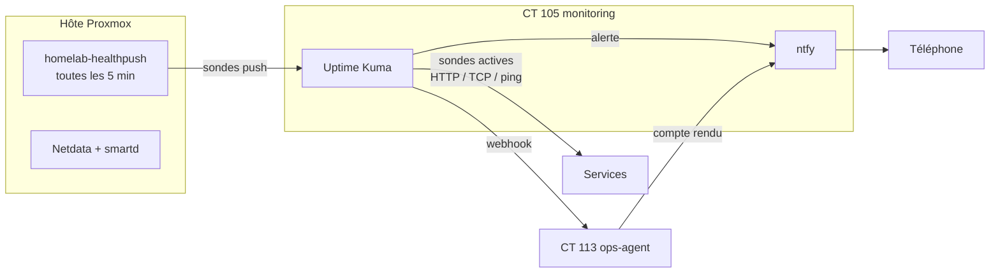
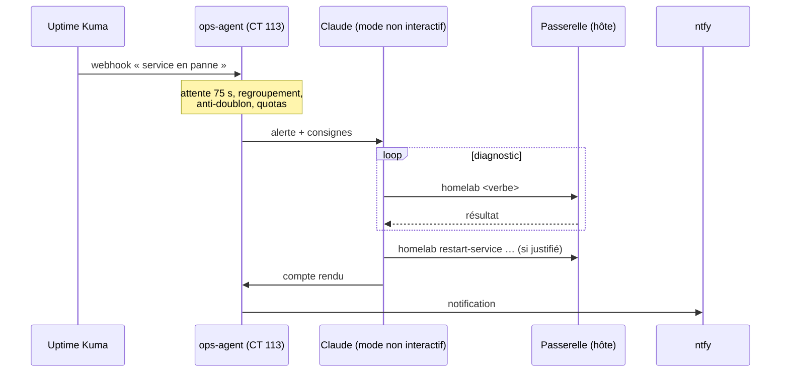

# Supervision et agent IA

## Supervision

Deux familles de sondes dans Uptime Kuma :

- **Sondes actives** : Kuma interroge chaque service (HTTP, TCP, ping), y compris les sites publics vus de l'extérieur.
- **Sondes push** : un script de l'hôte signale toutes les 5 minutes ce que Kuma ne peut pas voir de lui-même. Si le signal cesse, la sonde tombe.

| Sonde push | Ce qu'elle vérifie |
|---|---|
| Capacité | Remplissage du thin pool et du disque racine |
| SMART | Santé du NVMe |
| Sauvegarde PBS | Succès de la sauvegarde de la nuit |
| Sauvegarde USB | Ancienneté de la dernière copie (seuil : 14 jours) |
| Sauvegarde Gokapi | Export quotidien effectué |
| CI runner | Exécuteur CI actif |

Les notifications partent sur **ntfy**, reçues sur le téléphone.

## Agent IA d'exploitation

Objectif : qu'une panne simple (service planté, conteneur arrêté) soit diagnostiquée, et si possible réparée, sans intervention — **sans jamais donner un accès root libre à un modèle de langage**.

### Garde-fous

**Un seul outil.** Le modèle ne peut exécuter qu'une commande, `homelab <verbe>`. Celle-ci ouvre une session SSH vers l'hôte avec une clé à **commande forcée**, restreinte à l'adresse du CT 113, sans terminal ni redirection.

**Liste blanche côté hôte.** La passerelle n'accepte qu'un ensemble fermé de verbes :

- *lecture* : état des invités et des services, journaux, capacité ;
- *action* : relancer un service ou un conteneur connu, démarrer un invité arrêté, réinitialiser la VM.

Tout le reste est refusé. Il n'existe aucun verbe permettant une commande libre.

**Exclusions.** Pas de redémarrage possible pour le serveur de sauvegardes, les bases de données, ni la supervision elle-même.

**Limites de débit.**

| Niveau | Limite |
|---|---|
| Passerelle | 2 actions par heure et par cible, 5 par heure au total |
| Agent | 3 analyses par heure, 8 par jour |
| Anti-doublon | Une même alerte n'est pas retraitée avant 30 minutes |

**Traçabilité.** Chaque appel à la passerelle est journalisé sur l'hôte ; chaque intervention produit un compte rendu sur ntfy.

**Arrêt d'urgence.** Un simple fichier « pause » dans le CT 113 suspend l'agent.

### Pourquoi cette conception

Le contrôle est placé **côté hôte**, pas dans les consignes données au modèle. Même si l'agent était trompé (par exemple par du texte malveillant dans un journal qu'il lit), il ne pourrait toujours faire que ce que la passerelle autorise : relancer quelques services, un nombre limité de fois.
